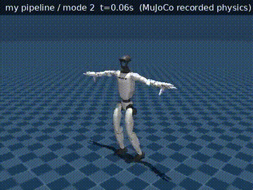
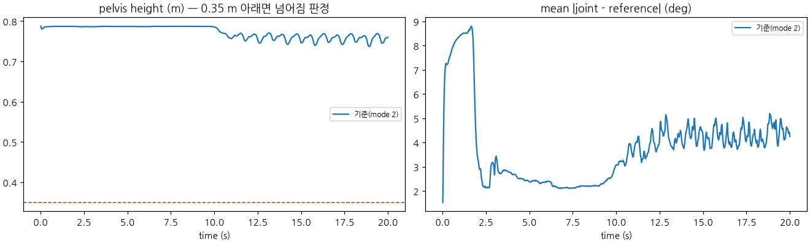
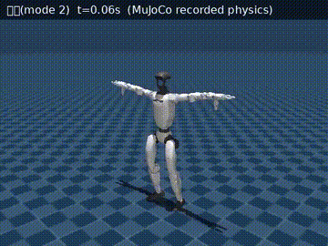

# 🤖 SONIC 실습 자동 리포트
`kehdgus9434/sonic-vibe-coding-lab` · 브랜치 `v1-agent-judgment` · 2026-11-25 01:03 UTC

**▶ Colab에서 내 브랜치로 열기**: [DAY1](https://colab.research.google.com/github/kehdgus9434/sonic-vibe-coding-lab/blob/reports/v1-agent-judgment/colab/day1_anatomy.ipynb) · [DAY2](https://colab.research.google.com/github/kehdgus9434/sonic-vibe-coding-lab/blob/reports/v1-agent-judgment/colab/day2_bughunt.ipynb) · [DAY3](https://colab.research.google.com/github/kehdgus9434/sonic-vibe-coding-lab/blob/reports/v1-agent-judgment/colab/day3_experiment.ipynb)
> 열면 0번 셀의 REPO/BRANCH가 이 브랜치로 채워져 있고 `my_work` 코드를 불러옵니다. 🔮 예측·🧾 검증 기록은 거기서 **직접** 작성하세요.

> 이 리포트는 코드가 실행되는지와 체크 결과를 보여 줄 뿐입니다. ✅가 '맞는 이유'로 나왔는지 판단하는 것은 당신의 몫입니다.

## Day 1 — `my_work/day1.py`

| 미션 | 결과 |
|---|---|
| 1-1 ONNX 입출력 | ⬜ 미작성 |
| 1-2 Encoder 블록 표 | ⬜ 미작성 |
| 1-3 쿼터니언 순서 | ⬜ 미작성 |
| 1-4 50 Hz 정렬 | ⬜ 미작성 |
| 1-5 Mode-2 Encoder 입력 | ⬜ 미작성 |
| 🚀 A. Mode-0 Encoder 입력 | ⬜ 미작성 |

## Day 2 — `exercises/buggy_pipeline.py` + `my_work/day2.py`

> 정답 비교는 하지 않습니다. 아래는 **내 불변식 테스트**와 **물리 실행 결과**뿐입니다. 최종 판정은 Colab Mission 2-3에서.

- 내 불변식 테스트: ⬜ 미작성
- BUGLOG 기록: 0개

| 조건 | 프레임 | 완주 | 중단 이유 | 최저 골반 높이(m) | 관절 RMSE(°) |
|---|---|---|---|---|---|
| 5초 | 47/250 | ❌ | fall_height_or_pelvis_tilt | 0.337 | 43.75 |

## Day 3 — `my_work/day3.py`

| 조건 | 프레임 | 완주 | 중단 이유 | 최저 골반 높이(m) | 관절 RMSE(°) |
|---|---|---|---|---|---|
| 기준(mode 2) | 1000/1000 | ✅ | completed_requested_interval | 0.737 | 6.48 |

실행 시간 58s · 영상(mp4)은 Actions 실행 페이지의 Artifacts에 있습니다.